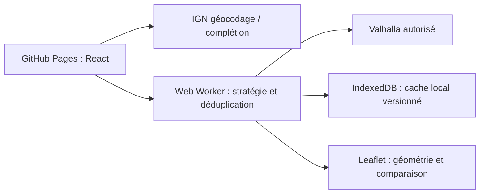
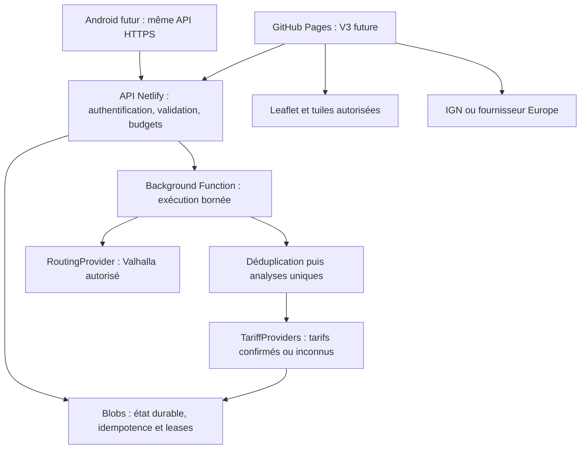

# Architecture du prototype dynamique V3 — étude du 30 octobre 2026

## Décision recommandée

**Conserver React/TypeScript/Vite sur GitHub Pages et ajouter un petit backend Netlify, en offre Free à crédits, avec Background Functions et Netlify Blobs.** Un job asynchrone réalise les calculs ; le navigateur affiche l’avancement, la carte et les résultats. Le même contrat HTTP pourra servir à Android. La recommandation porte sur le prototype personnel ; le passage public dépend encore du contrat de routage.

Pour le **prototype personnel fermé**, retenir IGN Géoplateforme pour les adresses françaises et le fournisseur Valhalla FOSSGIS déjà expérimenté, avec une seule recherche active, cadence globale contrôlée, cache autorisé par les conditions applicables et aucun engagement de disponibilité. Le navigateur seul reste une option encore plus légère pour un essai strictement personnel ; il n’est pas écarté pour une raison de convention.

Pour une **ouverture publique**, conserver le même backend mais changer le fournisseur de routage après validation technique **et contractuelle**. Stadia Maps est un candidat Valhalla techniquement crédible ; **ses conditions actuelles interdisent le proxy/cache serveur standard** sans exception/accord applicable. Son abonnement à 20 $ n’achète pas automatiquement ce droit. Il faut donc un accord adapté ou un autre hébergement Valhalla géré autorisant ce fonctionnement. Le budget de cette prestation reste à confirmer : ce point bloque une promesse de service public complet, pas le prototype personnel.

**Aucun moteur, compte, service, secret ou déploiement n’est créé dans cette étude.** Branche `experiment/dynamic-v3-architecture`, issue de `main`. La V2, ses données, son chemin `/route-optimizer/` et son workflow restent intacts.

## 1. Base de dimensionnement et limites de cette étude

Résultats précédents, consultables au [commit de validation](https://github.com/NogeomHub/route-optimizer/blob/6171f70e2117c98ca07a2588c8f793fb51377e01/experiments/valhalla/validation/REPORT.md) :

|Cas|Routages|Analyses uniques|Total utile, hors géocodage/statut|
|---|---:|---:|---:|
|Contrôle sans exposition, arrêt proposé à valider|9|2|11|
|Contrôle, candidate gelée|12|2|14|
|Paris → Rennes|31|10|41|
|Lyon → Bordeaux|40|15|55|
|Crans → Le Pin|40|28|68|

La candidate conserve neuf sondes, quatre pénalités, deux alternatives au maximum, raffinement, stagnation et plafond 40. **40 n’est pas un plafond du nombre total d’appels** : jusqu’à 120 géométries différentes seraient théoriquement possibles, donc 160 appels route/analyse si toutes nécessitent une trace.

À une cadence de 1 requête/s, 68 appels impliquent déjà environ 68 secondes de départs séquentiels, hors latence. Avec la pause prudente de deux secondes de nos campagnes, l’ordre de grandeur minimal d’attente est de 136 secondes, avant les temps de calcul/réseau. Une attente interactive de plusieurs minutes est plausible. Aucun percentile de latence n’est mesuré ici ; les hypothèses 240/600 secondes du budget ne sont pas des mesures.

Les documents ont été consultés le **30 octobre 2026**. Liens, HTTP obtenus et SHA-256 : [SOURCES.md](SOURCES.md), [manifest.json](sources/manifest.json). Les liens 403/404 et pages de redirection légères ne fondent aucun chiffre. Les pages intégrales sont conservées temporairement dans l’environnement ; seules références, empreintes et observations nécessaires sont versionnées. Prix en **USD/mois, hors taxes**, sans convertir artificiellement en euros.

## 2. Architecture A — tout dans le navigateur : possible, sous conditions

### Ce qui a été réellement vérifié

Les [sondes HTTP](sources/cors-probes.json) ont envoyé l’Origin `https://nogeomhub.github.io` :

- `/status` FOSSGIS : HTTP 200, `Access-Control-Allow-Origin: *` ;
- prévols `OPTIONS /route` et `/trace_attributes` : HTTP 204, POST/GET/OPTIONS et `Content-Type` autorisés ;
- géocodage et complétion IGN : HTTP 200 et Origin autorisé ;
- l’exemple **« 8 rue de Verdun Le Pin »** renvoie notamment **8 Rue de Verdun, 77181 Le Pin**, coordonnées `[2.628153, 48.914911]`, mais aussi des candidats dans d’autres communes : il faut laisser choisir l’utilisateur.

Ce sont des observations d’en-têtes et de prévols, **pas un test complet de POST routage/trace dans tous les navigateurs**. Aucun nouvel itinéraire n’a été calculé pour cette étude. Un mini-test navigateur réel devra confirmer POST, erreurs, annulation et contexte réseau de l’entreprise. Utiliser `credentials: omit` avec ces API publiques : wildcard et cookies authentifiés ne sont pas une combinaison à supposer fonctionnelle.

### Évaluation honnête

|Aspect|Prototype personnel|Service public|
|---|---|---|
|CORS|Compatible d’après les sondes actuelles ; encore à tester de bout en bout|Chaque fournisseur doit autoriser l’Origin ; aucune stabilité contractuelle déduite d’un en-tête|
|Quotas|Une seule recherche, séquentielle, usage ponctuel et cache local possibles|Plusieurs navigateurs ne savent pas garantir ensemble le quota global d’un service public|
|Latence|Premières variantes progressives ; calcul en Web Worker pour garder l’UI réactive|Plusieurs minutes possibles ; répéter 40 requêtes chez chaque nouvel utilisateur coûte cher|
|Cache|IndexedDB, pas uniquement localStorage ; sensible à purge/quota, origine et navigation privée|Pas de mutualisation entre utilisateurs/appareils|
|Sécurité|Pas de secret à exposer si fournisseur sans clé ; traiter les réponses comme données|Une clé en `VITE_*` ou dans le JS est publique ; origine restreinte ≠ secret ni authentification|
|Fiabilité|Onglet ouvert ; reprise locale possible|Fermeture, veille, réseau mobile et suspension navigateur interrompent les recherches|
|Maintenance|Très faible au départ|Couplage aux CORS, clés publiques, quotas et conditions de chaque fournisseur|
|Android|La logique TypeScript peut être réutilisée dans une enveloppe web ; pas d’API métier commune|Le code natif devrait réimplémenter/reprendre orchestration et stockage ; Android n’est pas soumis à CORS mais reste soumis aux quotas et conditions|

**Verdict A : bon premier essai privé à 0 $, mauvais socle pour un service public avec quotas partagés, clés et cache mutualisé.** Un fournisseur commercial permettant l’appel direct et le cache client pourrait prolonger cette architecture ; cela ne résout pas la reprise fiable, les secrets d’un APK ni les droits de cache.

Un navigateur ne peut pas remplacer librement son User-Agent ; ne pas promettre un user-agent de script personnalisé. Conserver le Referer normal et vérifier que le fournisseur accepte ce client. Les règles Nominatim/FOSSGIS s’appliquent aussi aux applications web. Une architecture frontend sans backend n’autorise pas davantage de requêtes.

## 3. Plateformes serverless : limites officielles qui comptent

### Capacité d’exécution

|Plateforme|Offre gratuite observée|CPU / mémoire|Durée et limites importantes|Adéquation à notre recherche|
|---|---|---|---|---|
|**Cloudflare Workers** [limites](https://developers.cloudflare.com/workers/platform/limits/)|100 000 invocations/jour|10 ms CPU/invocation ; 128 MB|HTTP sans durée murale maximale tant que le client reste connecté ; **50 sous-requêtes externes/invocation** ; `waitUntil` ne maintient pas un job plusieurs minutes après déconnexion|Une invocation Free ne peut pas promettre 68 appels sortants ni assez de CPU pour décoder/dédupliquer toutes les géométries. Étapes courtes ou plan payant nécessaires|
|Cloudflare Workers Paid|Minimum **5 $/mois** ; 10 M requêtes et 30 M ms CPU inclus|CPU par défaut 30 s, configurable jusqu’à 5 min ; 128 MB|Limites Paid d’appels sortants nettement supérieures (10 000 dans la table consultée) ; aucune nécessité de rester lié au navigateur avec un véritable orchestrateur|Bon choix de repli avec Workflows ou Durable Objects ; plus de concepts à gérer que le petit job Netlify|
|**Vercel Functions, Fluid Compute Hobby** [limites](https://vercel.com/docs/functions/limitations)|1 M invocations, 4 CPU-heures, 360 GB-heures, 100 GB transfert selon la grille Hobby|2 GB maximum Hobby|**300 s maximum** ; corps/réponse bufferisée 4,5 MB ; mémoire provisionnée facturée même durant attente|Peut convenir à certains cas, pas garantir nos recherches longues. Workflow ou checkpoints nécessaires pour dépasser le plafond|
|**Supabase Edge Functions Free** [limites](https://supabase.com/docs/guides/functions/limits)|500 000 invocations ; DB 500 MB, fichiers 1 GB, egress 5 GB ; deux projets|**2 s CPU/requête**, 256 MB|**150 s wall clock**, idle HTTP 150 s ; payant 400 s wall clock mais idle reste à traiter ; mise en pause des projets Free après une semaine sans activité|Un job unique froid complexe est fragile sous 150 s ; découpage externe nécessaire. Très utile si auth/Postgres existent déjà, sinon services superflus|
|**Netlify Functions, nouveaux plans à crédits** [configuration](https://docs.netlify.com/build/functions/configuration/)|**300 crédits/mois**, limite dure|1 GB et 0,5 vCPU par défaut ; montée en mémoire réservée aux offres indiquées par les docs|Sync **60 s**, scheduled 30 s, **Background 15 min** ; buffer 6 MB, background 256 KB|**Background Functions accessibles sur Free actuel**, contrairement aux anciennes offres Legacy. Adapté si un job est borné et ses résultats stockés séparément|

L’attente réseau n’est pas du CPU Cloudflare/Supabase, mais reste du **temps mural** ; chez Netlify le calcul en GB-heures inclut la durée de réservation mémoire, donc aussi l’attente des API. Ne pas confondre « 40 requêtes utilisateur » et « 40 appels sortants » : un seul job peut en déclencher 68 ou davantage.

Cloudflare Workflows est disponible Free/Paid, mais **ce n’est pas un contournement gratuit automatique** : la doc annonce 10 ms CPU Free et 3 000 étapes/jour, 1 GB-mois de stockage ; les documents de limites/prix décrivent le CPU à des granularités différentes (step/invocation). Aucun benchmark ne démontre ici qu’un traitement complet de géométries tient dans ce budget. Les étapes et le stockage sont facturables depuis août 2026. Durable Objects SQLite est également disponible Free, mais les limites de calcul, stockage et l’orchestration doivent être testées. Ne pas ajouter les deux systèmes à notre premier prototype sans besoin démontré.

### Cache, secrets et déploiement

|Plateforme|Stockage / cache|Secrets, CORS et GitHub|Complexité pour ce projet|
|---|---|---|---|
|Cloudflare|Cache API local au centre de données, sans garantie de conservation ; KV Free 100 k lectures/j, 1 k écritures/j et 1 GB ; D1 Free 5 M lignes lues/j, 100 k écrites/j, 5 GB ; DO SQLite pour coordination|Secrets côté serveur ; allowlist CORS ; Workers Builds ou GitHub Actions|Très bon à faible coût ; KV n’est pas un verrou global à cause de sa cohérence éventuelle. DO/Workflows robustes mais ajoutent un modèle d’exécution|
|Vercel|Pas de cache durable garanti en RAM ou `/tmp` ; stockage externe/Marketplace à budgéter séparément|Variables secrètes, CORS à implémenter ; déploiement Git natif|Simple pour une fonction courte, moins simple avec un workflow durable ; **Hobby réservé à l’usage personnel non commercial**|
|Supabase|Postgres pour jobs/verrous/cache et Storage pour blobs ; RAM d’Edge non persistante|Secrets de fonctions ; CORS ; déploiement CLI/CI GitHub avec token secret, intégration Git des branches à distinguer du déploiement des fonctions|Cohérent si l’on veut bientôt comptes/DB ; trop d’éléments pour le seul prototype routage|
|**Netlify**|**Blobs** : stockage persistant indépendant des déploiements, lecture forte disponible, écritures atomiques conditionnelles `onlyIfNew`/`onlyIfMatch` et ETag|Secrets de fonctions ; API cross-origin contrôlée ; connexion Git native, branches/previews ; aucune clé dans le bundle|Le plus simple ici pour un job JavaScript de quelques minutes + état/cache sans nouvelle base SQL|

Prix Netlify actuels : Free 300 crédits, Personal **9 $ / 1 000 crédits**, Pro **20 $ / 3 000 crédits** de départ. Compute 10 crédits/GB-heure, bande passante web 20 crédits/GB, web requests 2 crédits/10 000, chaque production deploy réussi 15 crédits ; previews/branch deploys 0 crédit de déploiement. Les addons Personal sont 5 $/500 crédits, recharge optionnelle désactivée par défaut. Atteindre le plafond Free peut suspendre les projets de l’équipe : ce n’est pas seulement une requête isolée qui échoue. Ne pas employer les anciens chiffres Netlify « 125 k fonctions gratuites » pour un nouveau compte à crédits.

Supabase Pro commence à **25 $/mois** ; Cloudflare Paid à 5 $. Vercel Hobby ne doit pas être budgété comme un hébergement commercial gratuit. Aucun compte de ces services n’a été ouvert ici ; le parcours de création, les conditions d’équipe et un éventuel paiement restent des actions futures explicites de l’utilisateur.

## 4. Valhalla : le fournisseur est la décision critique

### FOSSGIS pour usage personnel restreint

Les expérimentations démontrent l’API, ses paramètres et les traces. Les conditions imposent une requête/s maximum et une connexion pour les scripts, un client identifiable et l’attribution ; interdisent le téléchargement massif et les usages commerciaux où ce service constitue une partie essentielle de l’offre. Elles ne promettent pas de disponibilité et peuvent changer.

**Ce n’est pas un backend de production gratuit pour 1 000 recherches publiques/mois.** Même un total mensuel apparemment modeste n’autorise pas automatiquement un usage central d’application. Un proxy serverless ne change pas ces conditions et ne doit pas répartir des appels sur plusieurs IP pour contourner les limites.

Prototype personnel : une seule recherche active, file bornée, pause de deux secondes, cache, arrêt sur 429/erreurs prolongées, aucun rejeu massif. Avant publication du futur prototype, prévoir attribution, lien de signalement OSM et contact opérateur directement accessible conformément aux conditions FOSSGIS. Prévoir un endpoint configurable côté serveur et la possibilité d’arrêter le prototype si le service le demande.

### Valhalla géré : candidat Stadia Maps, avec vrai blocage de cache

Les docs officielles [routage](https://docs.stadiamaps.com/routing/standard-routing/), [guide costing](https://docs.stadiamaps.com/guides/getting-the-best-routes-with-valhalla-turn-by-turn-directions-apis/) et [trace attributes](https://docs.stadiamaps.com/routing/trace-attributes/) présentent un service basé sur Valhalla : `costing_options`, `use_tolls`, `toll_booth_penalty`, `toll_booth_cost`, alternatives et attributs routiers. Endpoints distincts de FOSSGIS, par exemple `/route/v1`. Un adaptateur est nécessaire, pas une substitution aveugle d’URL. L’API automobile standard documente jusqu’à 5 000 km à vol d’oiseau et 50 lieux.

[Tarifs consultés](https://stadiamaps.com/pricing/) : Free **200 000 crédits/mois**, non commercial, sans dépassement ; Starter **20 $ / 1 M crédits**, dépassement optionnel **0,03 $/1 000 crédits** ; Standard 80 $ / 7,5 M ; routage standard et trace attributes **20 crédits/requête chacun**. Ne pas utiliser des tarifs historiques à 20 000 crédits gratuits. L’accès exact aux options/attributs sur le compte retenu et leur prise en compte doivent être validés par quelques appels autorisés, pas déduits du seul HTTP 200 ou d’une bibliothèque SDK.

**Conditions déterminantes :** les [conditions en vigueur du 18 mars 2026](https://stadiamaps.com/terms-of-service/) et la [page de limites](https://docs.stadiamaps.com/limits/) interdisent le proxying/bulk caching hors exceptions ou accord ; le texte précise « server-side caching is prohibited ». Le cache client standard est limité aux en-têtes HTTP, ou sept jours sans en-tête. La version déjà annoncée pour le **9 novembre 2026** conserve la restriction pertinente ; elle n’est pas présentée comme déjà entrée en vigueur le 30 octobre.

**Conséquence : ne pas brancher Stadia sur le cache partagé/stockage des jobs proposé ci-dessous sans accord applicable.** Une souscription Starter ne résout pas automatiquement ce problème. L’usage backend pour le produit, le stockage temporaire des résultats asynchrones, le cache, les recherches multiprofils et le débit doivent être précisés avec le fournisseur. Les conditions restreignent aussi le benchmarking face à des concurrents et l’amélioration de services concurrents : obtenir les autorisations nécessaires avant une comparaison inter-fournisseurs. Aucun message ne lui a été envoyé, aucun compte ni clé créé. Les montants publics permettent seulement une simulation de consommation, pas le prix garanti d’un contrat autorisant notre architecture.

### Auto-hébergement et autres moteurs

- Valhalla peut tourner sur une machine **cloud**, pas nécessairement chez soi : routage C++ et tuiles OSM France/Europe, construction et mises à jour du graphe, stockage, mémoire, supervision et sauvegarde. Cela préserve tous les paramètres et permet un cache sous maîtrise du projet, avec obligations OSM.
- **Une fonction serverless 128–256 MB n’est pas une instance Valhalla France.** Elle peut orchestrer, pas embarquer sans dimensionnement le moteur et le graphe. Aucun coût RAM/disque France précis n’a été mesuré ici ; un devis d’hébergement géré est préférable à un faux prix VPS de production.
- Un conteneur managé n’élimine pas la maintenance du graphe. Les services gratuits qui dorment et leurs disques éphémères ne sont pas une base fiable pour ce graphe volumineux.
- GraphHopper et ses modèles personnalisés, openrouteservice, Geoapify et d’autres APIs peuvent être étudiés, mais une option binaire « avoid tolls » ne remplace pas notre espace de pénalités. **Aucun de ces fournisseurs n’est déclaré équivalent** sans refaire des tests de diversité, d’alternatives et d’attributs ; il serait trompeur d’échanger le moteur en conservant la conclusion du POC.

## 5. Géocodage France, Europe et saisie naturelle

**France : IGN Géoplateforme**, pas l’ancienne URL BAN `api-adresse.data.gouv.fr`, dont la page officielle annonce le décommissionnement fin janvier 2026.

- Géocodage : `https://data.geopf.fr/geocodage/search` ; limite documentée **50 requêtes/s/IP**.
- Complétion distincte : `https://data.geopf.fr/geocodage/completion/` ; **10 requêtes/s/IP**, pas 50. Les deux routes ne partagent pas nécessairement les mêmes règles.
- Test réel : l’adresse d’exemple a été trouvée, avec CORS. Les résultats concurrents montrent pourquoi ville/code postal et choix explicite sont nécessaires.
- Debounce 350–500 ms proposé, trois caractères minimum, annulation des requêtes précédentes, cinq suggestions maximum, limiter les appels par utilisateur et globalement, traiter `Retry-After`/429. Pas de requête à chaque touche sans contrôle.
- Utiliser la sélection d’une suggestion ou une résolution finale confirmée ; ne pas router un premier résultat ambigu. Montrer les deux points sur la carte avant la recherche coûteuse, notamment si une entrée est un centre communal ou manque de numéro.
- Les services sont accessibles publiquement pour ces opérations ; aucun secret n’a été nécessaire aux sondes. Les index adresses/toponymes ont leurs propres sources et conditions ; conserver provenance/licence, ne pas inférer que toutes les couches IGN ont la même licence que la BAN.

**Europe :** ajouter un fournisseur de géocodage séparé, pas changer le fournisseur de routage. Geoapify documente un Free **3 000 crédits/jour, 5 requêtes/s, sans carte, commercial possible avec attribution et limites** ; c’est un candidat de géocodage, dont coût par opération, droits de stockage et résultat d’autocomplétion doivent être confirmés. La tentative de FAQ générale a retourné 404 ; elle n’est pas une preuve de droit de cache. Les services Pelias/Photon gérés sont d’autres pistes.

**Nominatim public** : maximum absolu 1 requête/s pour l’application, identification, attribution et cache ; **autocomplétion interdite** par sa politique. Acceptable pour une recherche soumise ponctuelle, pas pour notre champ de suggestions public. Le serveur de démonstration Photon accepte un usage raisonnable sans SLA et peut limiter/bannir les gros usages ; ce n’est pas une alternative gratuite de production garantie.

L’API de communes utilisée par les POC n’est pas un géocodeur d’adresses. « N’importe quel départ/destination » signifie une saisie libre, avec erreurs de couverture ou de routage explicites ; pas une promesse de géocodage mondial ni de tarifs France complets.

## 6. Trois architectures complètes et budgets

|Architecture|Composition|Complexité / fiabilité / évolution|
|---|---|---|
|**A — navigateur seul**|GitHub Pages, IGN direct, Valhalla direct autorisé, Web Worker + IndexedDB|La plus simple et gratuite en personnel ; dépend du maintien de l’onglet, CORS et cache local ; migration métier nécessaire pour mutualiser ou servir Android natif|
|**B — recommandée**|GitHub Pages inchangé, API Netlify, Background Functions, Blobs, fournisseur Valhalla autorisé|Petit backend indépendant, jobs reprenables et cache partagé sous conditions ; deux déploiements et CORS, mais pas de migration du frontend ; API réutilisable Android|
|**C — tout Netlify**|Nouvelle V3 React sur Netlify + mêmes fonctions/Blobs|Un seul dépôt/projet et origine, donc CORS simplifié ; mêmes limites et coûts compute, mais migration/hébergement supplémentaire inutile maintenant. Pertinent si l’on quitte Pages pour un service commercial|

GitHub Pages reste réservé à du statique. Sa documentation interdit de l’employer principalement pour héberger une activité commerciale/SaaS ; réexaminer cette condition avant monétisation, même si le trafic est bas. Le service public gratuit personnel actuel n’est pas modifié par cette étude.

### Hypothèses explicites de coûts

Pour comparer l’infrastructure B/C : un utilisateur personnel = **10 recherches froides/mois** ; chaque job réserve **1 GB pendant 240 à 600 s**, 2 MB de réponses sortantes, 50 requêtes HTTP de contrôle/progression, quatre production deploys/mois. Ce sont **hypothèses**, pas des durées, tailles, cache-hit ou factures mesurés. Les données de stockage Blobs, transferts supplémentaires, logs, autres projets et pics doivent être suivis au pilote. Les tuiles ne transitent pas dans ce backend.

|Architecture|Personnel, 10/mois|100/mois|1 000/mois|
|---|---:|---:|---:|
|A, infrastructure seule|0 $|0 $|0 $ sous limites de l’hébergement statique ; pas une autorisation d’usage du routeur public|
|B, infrastructure Netlify sous hypothèses|0 $ Free|0 $ Free|**9–19 $** Personal, ou Pro 20 $ pour plus de marge|
|C, infrastructure Netlify sous hypothèses|0 $|0 $|Même ordre de grandeur **9–19 $**, plus trafic/déploiements frontend non comptés|
|B alternatif Cloudflare Paid + cache/DO SQLite|Minimum 5 $|Environ 5 $ si inclusions respectées|Environ 5 $ si CPU/durée/stockage inclus ; pas une mesure de facture|

Netlify B : consommation calculée **67–77**, **132–232**, **777–1 777 crédits/mois** respectivement. Formule : `R × secondes / 3600 × 1 GB × 10` + `R × 0,002 GB × 20` + `R × 50 / 10 000 × 2` + `4 × 15`. À 1 000 recherches, 1 000 crédits Personal suffisent au scénario 240 s ; le scénario 600 s demande deux packs supplémentaires de 500 crédits (9 + 5 + 5 = 19 $), à activer explicitement. À 10 MB plutôt que 2 MB par recherche, ajouter 160 crédits pour 1 000 recherches. La consommation Free est **journalière chez Cloudflare**, mensuelle à crédits chez Netlify : une moyenne mensuelle ne garantit pas le passage d’un pic.

Cloudflare Paid : 1 000 jobs conservativement actifs dix minutes à 128 MB représentent environ 75 000 GB-s, sous les 400 000 GB-s DO mensuels inclus ; mais les objets laissés actifs, le nombre d’invocations, les données et l’usage d’autres projets changent le coût. Ce n’est pas une raison de créer DO + Workflows + D1 + KV simultanément.

### Ajouter le routage : ne pas confondre hébergement et API

- **Personnel restreint, FOSSGIS autorisé et raisonnable : 0 $ de redevance**, sans garantie ni droit d’étendre ce régime à un service public.
- **Service public : coût du Valhalla géré autorisant nos usages = devis/accord encore manquant.** Les tableaux d’infrastructure ne sont pas une promesse de coût total.
- À titre de **simulation des seuls crédits Stadia**, sans prétendre que le cache serveur est autorisé : 41 appels × 20 crédits = 820 crédits/recherche ; 68 appels = 1 360 crédits/recherche. Dix ou 100 recherches froides restent sous 200 000 crédits Free pour un usage admissible non commercial ; 1 000 recherches classiques donnent 820 000 crédits (Starter 20 $), 1 000 complexes donnent 1 360 000 crédits (Starter 20 $ + 10,80 $ de dépassement optionnel). Un usage commercial exige déjà une offre payante même en dessous du quota gratuit.
- Ces montants **n’incluent pas** l’accord de proxy/cache, cartes, géocodage payant, trafic premium ou dépassements/retries. Ils ne sont donc **pas** le prix garanti du service public recommandé. Le [CSV de scénarios](cost-scenarios.csv) expose l’arithmétique à froid ; aucun taux de cache favorable n’est inventé.

Le budget personnel complet peut ainsi être **0 $** sur A ou B, sous conditions d’usage ; le budget public complet est **infrastructure + routeur contractuellement adapté**, encore non chiffrable de façon fiable. Ce constat est plus utile qu’une promesse « toute la France gratuitement ».

## 7. Backend recommandé et exécution des jobs

Contrat proposé, **pas encore implémenté** :

1. `POST /v1/searches` reçoit les coordonnées confirmées, profil véhicule, options autorisées et clé d’idempotence ; il valide, vérifie auth/quota/cache et crée un identifiant.
2. Un lanceur court stocke le job puis déclenche la fonction background et attend son accusé d’acceptation. Il renvoie `202 { searchId, statusUrl }`. **L’accusé Netlify background natif est vide** : ne pas compter sur lui pour retourner le résultat ou créer le protocole frontend.
3. Le runner utilise un payload inférieur à **256 KB** contenant l’identifiant, pas les 28 géométries. Il lit l’état et son lease, calcule par étapes, sauvegarde après chaque réponse utile, déduplique avant traces, applique budget de temps et plafond de profils.
4. `GET /v1/searches/{id}` renvoie phases/progrès et variantes disponibles ; polling espacé avec backoff, pas 20 requêtes/s. `GET /v1/routes/{id}/geometry` charge les tracés à la demande ; le GeoJSON volumineux ne traverse pas une unique réponse bufferisée >6 MB.
5. `DELETE /v1/searches/{id}` marque une annulation, vérifiée entre appels. Une réponse perdue ou une fermeture du navigateur n’efface pas l’état. Les jobs expirent et les résultats partiels restent clairement partiels.

**Ordonnancement personnel :** un seul job actif et une seule connexion amont FOSSGIS, tous utilisateurs/instances confondus. Utiliser les lectures fortes et écritures conditionnelles Blobs pour un lease global par fournisseur, un numéro de génération et `nextAllowedAt`, renouvelé tant que l’appel est en cours ; vérifier l’ETag à chaque transition. Une variable globale JavaScript ou un `setTimeout` par invocation n’est pas un verrou distribué. Si le lease ne peut pas être acquis, ne pas lancer une autre recherche en parallèle.

**Retries :** Netlify background peut réessayer automatiquement après une minute puis deux minutes. Le runner doit donc être idempotent, vérifier l’état terminal et reprendre à l’étape manquante, jamais recommencer 40 profils. Traiter les erreurs attendues sans relancer aveuglément tout le job, respecter 429/Retry-After. Un timeout HTTP amont ambigu ne permet pas de garantir « exactement une facturation » ; prévoir marge et retries très bornés.

Pour limiter le couplage à l’hébergeur : stratégie pure et déterministe, `RoutingProvider` et `TariffProvider` pour les données, `JobStore` pour lecture/écriture conditionnelle et expiration, puis adaptateur `JobRunner` Netlify. Le port TypeScript futur se vérifiera contre les fixtures des campagnes Python ; le métier ne doit pas dépendre directement du SDK Blobs. Changer de runner ou de stockage ne doit pas modifier le contrat utilisé par le web et Android.

**Limite 15 minutes :** budget interne plus court (par exemple huit minutes à calibrer), timeouts par appel, résultat partiel explicite, reprise manuelle ou job suivant depuis checkpoint. Ne pas promettre que 160 appels externes lents tiennent dans 15 minutes. Si le pilote dépasse régulièrement cette durée, migrer le runner vers Cloudflare Workflows Paid ou un service de jobs adapté sans changer l’API du frontend.

La région Netlify par défaut documentée est aux États-Unis : sélectionner une région européenne prise en charge pour les fonctions et Blobs, et vérifier les transferts/sous-traitants avant une ouverture publique. Un frontend GitHub Pages mondial ne constitue pas une garantie de résidence européenne des recherches.

**Sécurité :** API personnelle authentifiée dès le départ, secrets dans l’environnement de fonctions, pas `VITE_*`. Un mécanisme de connexion délivre un jeton court en mémoire ; ne pas supposer que les cookies cross-site entre `github.io` et `netlify.app` fonctionneront partout. Pour le public, passer à une identité OIDC et quotas par compte. CORS autorise les origines exactes, mais **n’est pas une authentification**, et l’Origin ne distingue pas deux chemins du même `nogeomhub.github.io`. Android utilise les mêmes jetons, pas un secret caché dans l’APK.

N’accepter ni URL amont arbitraire, ni options illimitées, ni géométrie géante du client : allowlist d’endpoints, tailles bornées, profils validés, limite de jobs et d’appels. Les clés de service restent côté backend ; les réponses sont des données, pas du HTML injecté dans les popups.

## 8. Cache : cinq couches, invalidation et proximité

**Règle supérieure : aucun cache au-delà des droits du fournisseur.** Chaque adaptateur indique `serverCacheAllowed`, durée maximale et attribution. Pour Stadia sans accord applicable, le cache serveur et les résultats de jobs persistés ne sont pas activés ; résoudre ce point avant de brancher ce fournisseur à l’architecture asynchrone. Même un stockage temporaire de résultat doit être clarifié, pas renommé pour contourner la restriction.

|Couche|Clé logique|Invalidation / usage proposé|
|---|---|---|
|Géocodage|fournisseur + requête normalisée + pays/langue/biais/bbox + version d’index si disponible|Proposition TTL 7 jours pour résultats positifs, minutes pour absence ; à plafonner par les droits/actualisations. Conserver texte original et choix confirmé|
|Réponses `/route`|fournisseur + coordonnées ordonnées exactes + paramètres auto complets + alternatives + langue/format + version moteur/graphe + heure/date si utilisée|Ne jamais inverser origine/destination. Clé JSON canonique, profil/algorithme versionnés ; `/status` mutualisé ou epoch conservateur si version non exposée|
|Géométries|hash de polyline/coordonnées complètes + précision/format + sens + fournisseur/graphe|Une géométrie identique est partagée entre profils ; ses droits et attribution restent attachés|
|Analyses|hash géométrie + graphe + `shape_match` + attributs demandés + costing|Une trace `edge_walk` ne se réutilise pas comme résultat d’un autre mode ou graphe ; attribut manquant = inconnu|
|Tarifs|séquence orientée des transactions + concession/version du catalogue + date d’effet/audit + classe véhicule + profil d’émission/remise + version du matcher|Recalculer lors d’un nouveau tarif sans rerouter si la géométrie reste valide ; un tarif incomplet garde ses raisons et sous-totaux|

Le résultat global de recherche référence ces couches et contient version d’algorithme, état d’achèvement, graphe et couverture tarifaire. Ne pas mettre le filtre de temps/économie dans la clé des appels Valhalla lorsqu’il ne fait que filtrer localement les mêmes candidats.

**Trajets identiques ou proches :** canonicaliser la représentation des mêmes coordonnées (précision choisie et documentée), pas arrondir arbitrairement à 100 m pour facturer un trajet différent. Deux points proches peuvent être sur des chaussées opposées, de part et d’autre d’une barrière, d’un cours d’eau ou d’une bretelle. Un index spatial peut trouver un cache candidat proche, mais il faut revalider le raccordement et les transactions ; aucun total en euros n’est réutilisé sur simple proximité. Pour la première V3, garantir le cache exact et reporter la réutilisation spatiale avancée.

Blobs : stores persistants liés au site, pas stores liés à chaque déploiement ; métadonnées séparées des grosses réponses compressées, cache à capacité bornée, TTL applicatif et purge. Commencer par une rétention courte (24 h pour réponses routières privées, maximum 7 jours sous droits adaptés), une limite totale de taille et un bouton d’effacement ; mesurer avant d’augmenter. Blobs n’est pas une raison de conserver sans limite des adresses personnelles.

Ne pas journaliser les adresses en clair par défaut ; les coordonnées sont également des données potentiellement personnelles et un simple SHA n’est pas une anonymisation. Chiffrement du transport, contrôle par propriétaire du job, suppression/expiration et limitation de logs sont nécessaires au passage public. Le cache du navigateur est distinct du cache serveur et peut être purgé par l’utilisateur ou le navigateur.

## 9. Android et périmètre exact de la V3

**Android : réutilisation du même backend HTTPS et des mêmes identifiants de jobs, modèles de résultats, règles de prix et cache.** Web et Android ne transportent pas chacun une copie du moteur de recherche. Le frontend natif futur devra seulement géocoder/choisir les lieux, lancer/suivre un job et afficher la carte ; le travail serveur survit à la suspension du client. Pas de développement Android, navigation native ou SDK de guidage dans cette étape.

V3 proposée :

- deux champs libres avec suggestions, sélection confirmée, pays et erreurs d’ambiguïté ; France d’abord, couverture Europe par fournisseur explicite ;
- recherche réelle avec stratégie gelée et budgets, cache exact, annulation et progression ; l’arrêt zéro exposition est une amélioration à valider/activer séparément ;
- tracés Leaflet réels, durée et distance réelles renvoyées par le moteur, attribution ; pas de trafic actualisé promis ni de guidage ;
- plusieurs candidats, frontière **temps/exposition** explicitement nommée quand les euros ne sont pas disponibles ; conserver les variantes potentiellement utiles pour la future tarification ;
- tarification uniquement des transactions couvertes et suffisamment fiables, classe 1 standard explicitée ; sinon **« tarif non disponible »** ou **« tarif incomplet »**, avec partie connue distincte et sources ;
- ne pas reprendre comme moteur dynamique le registre manuel Crans → Le Pin, ni inventer un tarif A79, ni extrapoler €/km ;
- frontière temps/euros seulement pour les totaux complets, avec avertissement de couverture ; si le trajet le plus rapide a un prix inconnu, son économie de référence et les €/minute en euros restent non calculables. Une heuristique de recommandation monétaire ne doit pas être appliquée à des kilomètres payants en changeant simplement le libellé ;
- UI V2 et son mode archivé conservés comme référence de régression ; distinguer clairement résultats pré-calculés et recherche réelle ;
- endpoints indisponibles, quotas, délais, résultats partiels, zéro solution et géométrie invalide traités sans faux repli.

À exclure de cette V3 : tarification nationale garantie, comptes multi-équipe complexes, paiements, profils poids-lourds, trafic premium, navigation temps réel et approximation nationale par distance payante.

## 10. Points juridiques et opérationnels réellement bloquants

- **Fournisseur de routage :** l’instance de recherche publique n’accorde pas un service de production ; obtenir une offre et des droits compatibles avec les recherches multiprofils, le proxy et le cache. La restriction Stadia est une condition explicite, pas un risque hypothétique.
- **OSM :** attribution et ODbL pour données et bases dérivées ; les droits sur les données ne donnent pas automatiquement un droit illimité sur les serveurs. Examiner le partage d’une base dérivée si elle devient un produit, sans conclure que tout le code applicatif doit être publié sous ODbL.
- **Tuiles `tile.openstreetmap.org` :** attribution visible, Referer normal, cache HTTP respecté, pas de bulk/offline prefetch ni garantie de disponibilité. Les tuiles ne sont pas un service gratuit illimité pour Android hors ligne ; fournisseur de tuiles adapté ou pack autorisé pour ce besoin.
- **Géocodage :** règles IGN par opération, Nominatim sans typeahead, droits distincts des jeux sources ; Geoapify/Stadia et autres ont des licences/quotas spécifiques. Les adresses et recherches peuvent relever de la protection des données.
- **Tarifs :** PDF officiel accessible ne signifie pas licence ouverte de redistribution massive. Nos cellules auditées ne suffisent pas à autoriser une base nationale APRR/AREA/APRR-exploitant/ALIAE ; vérifier droits, millésimes, identité des gares et classe/profil. Concession et exploitant ne se confondent pas.
- **Hébergement :** Free ne signifie pas SLA ou usage commercial autorisé partout ; limites de GitHub Pages et Vercel Hobby à revoir avant monétisation. Prévoir dégradation propre au quota, pas un débit automatiquement payant activé sans consentement.

## 11. Ordre de développement et décisions à lever avant le moteur

1. **Décider le périmètre personnel fermé et le fournisseur autorisé.** Sans accord public de cache, ne pas présenter la V3 comme un service public national. Aucun compte ne doit être créé automatiquement pour lever cette décision.
2. **Petit essai d’infrastructure isolé**, pas encore le moteur complet : un job Netlify background fictif de plusieurs minutes, fermeture/réouverture du client, ETag/lease sous deux déclenchements concurrents, reprise après retry, stockage/expiration et mesures des crédits. Le « fictif » concerne ce test d’orchestration, jamais des itinéraires ou tarifs affichés comme réels.
3. **Essai fournisseur de quelques appels autorisés** : prise en compte réelle de `use_tolls`, des quatre pénalités, de `alternates=2`, de `edge.toll` et `edge_walk`, gestion des erreurs et absence d’options ignorées ; confirmer version/graphe, cache, prix par appel, débit et compatibilité CORS si client direct. Ne pas lancer une autre campagne nationale pour ce contrôle.
4. **Valider géocodage et UX** : Le Pin ambigu, adresse sans numéro, accents, lieu hors France, point non raccordable ; budgets d’autocomplétion et consentement utilisateur avant routage.
5. **Puis seulement coder la V3 par couches** : contrat jobs → fournisseur routage → cache/dédup → algorithme → analyses → rendu → tarification couverte → observabilité. Réutiliser les abstractions `RoutingProvider`/`GeometryProvider`, en séparant dans le futur la création/suivi de jobs du simple tableau synchrone archivé.
6. **Tester les quatre corridors en régression**, erreurs/quotas/cache/déconnexion et coût mesuré ; ouvrir d’abord à quelques personnes, puis choisir l’offre et le fournisseur pour élargir.

**Choix final : B pour conserver l’existant et viser Android, A acceptable comme marche temporaire strictement personnelle, C possible plus tard sans nécessité immédiate.** Netlify Free est la première piste à éprouver pour l’orchestration ; Cloudflare Paid à 5 $ est le repli crédible si les jobs, limites ou coûts mesurés le justifient. Le vrai préalable public reste l’accès Valhalla contractuellement compatible et la couverture tarifaire honnête, pas l’écriture d’un backend complexe.
