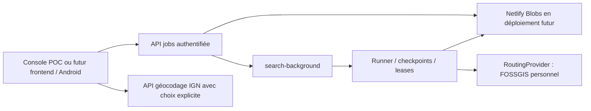

# POC backend V3 — résultats du 30 octobre 2026

**Verdict : orchestration, stratégie adaptative, API, progression, stockage local durable et réutilisation des résultats fonctionnent avec de vraies réponses Valhalla. Le code Netlify est construit, mais l’exécution Background Functions et Blobs hébergé ne sont pas encore validés : aucun compte/site n’a été créé.** L’étape suivante requiert l’action manuelle décrite dans [NETLIFY.md](NETLIFY.md).

Branche `experiment/netlify-v3-backend-poc`, issue du rapport `experiment/dynamic-v3-architecture` (`94b1b50`). Le produit V2 sur `main`, son jeu tarifaire, ses 28 géométries, son frontend et GitHub Pages sont inchangés. Aucun backend n’est branché à React, aucun PR/déploiement/fusion n’a été effectué.

## 1. Ce qui existe effectivement

Deux fonctions Node 22 : API synchrone et `search-background`. Un service `Jobs` partagé avec le serveur HTTP local ; un port `RoutingProvider` ; FOSSGIS comme adaptateur personnel explicitement activé ; IGN pour les adresses françaises ; adaptateur réel `@netlify/blobs` ; port de stockage/test local et console HTML séparée.

La même logique a été exécutée réellement sur HTTP local ; le runner est alors une tâche du processus Node et le store est `FileStore`, **pas un émulateur de disponibilité du cloud**. La console fournit une saisie, des choix de candidats, un jobId relisible, l’annulation, la reprise et le chargement d’un GeoJSON. Pas de refonte V2 ni de moteur tarifaire national.

## 2. Endpoints et données

Contrat principal : `POST /api/search`, `GET /api/search/:jobId`, `POST /api/search/:jobId/cancel`. Compléments : reprise `POST .../resume`, géométrie individuelle `GET .../routes/:routeId/geometry`, `GET /api/geocode`, contact/attribution `GET /api/about`.

Le POST valide/résout les lieux, renvoie les candidats ambigus avant tout routage, puis crée un job et retourne son propre 202 JSON après acceptation du déclenchement background. Le 202 natif Netlify est vide. Les coordonnées passées au test réel sont celles déjà archivées, explicitement choisies ; aucune adresse ambiguë n’a été arbitrairement résolue. Un appel IGN réel a également retourné les candidats pour « 8 rue de Verdun Le Pin » dans chaque test froid.

Objets Blobs, clés, TTL et exemples HTTP sont détaillés dans [README.md](README.md). Store prévu : `route-optimizer-v3-poc` ; espaces `jobs`, `results`, `geometries`, `search-index`, `locks`, `schedule`, `cache` et `network`.

Résultat : durées et distances réelles, référence de géométrie réelle, exposition issue de traces strictes, paramètres/provenance et **`pricingStatus: "not_computed"`** partout. Aucun zéro tarifaire inventé. Le Pareto est nommé temps/exposition et ne prétend pas mesurer les euros.

## 3. Recherche et sécurité de l’exécution

- Port de la candidate gelée Python : neuf sondes, pénalités 0/300/900/1800, `alternates=2`, grille historique, choix de milieu déterministe donnant priorité aux réponses observées différentes, exploration plate, stagnation huit après minimum douze et plafond quarante.
- Régression sur les vrais profils archivés : ordre identique à Python, 40 profils, 117 candidats, 28 représentants. Le choix ne consulte ni réponses futures ni tarifs/identifiants Pareto.
- Déduplication avant traces : identité de polyline, puis approximation historique de corridor ≥99,9 % avec durée/distance ±0,25 %. Provenance des alternatives et réponses brutes conservées ; cela ne prouve pas une équivalence topologique pour tarifer plus tard.
- Traces `edge_walk` uniquement : attributs péage requis, unités, indices, longueur et extrémités vérifiés. Rien n’est inféré « gratuit » sur attribut absent.
- Une campagne active par fournisseur et par store/site ; appels séquentiels, pause ≥2 s après réponse, identité applicative et Referer. Pas de changement d’instance/IP pour contourner une erreur. Une autre recherche distincte peut être refusée plutôt que placée dans une file non implémentée.
- Leases de 180 s, CAS/ETag, compteur de génération pour empêcher une revendication obsolète, propriétaire unique du runner, checkpoint de profils/analyses, contrôles entre opérations. Le timeout HTTP de 90 s reste inférieur au lease. Atomicité cloud à vérifier sur le vrai service.
- Token personnel pour l’API, secret interne distinct pour le background, Origin explicites, corps/options bornés, aucun endpoint arbitraire ni secret frontend. Ce POC mono-opérateur n’est pas une solution d’authentification/anti-abus publique.

L’arrêt « sans enjeu de péage » est isolé derrière `POC_EARLY_NO_TOLLS` et inclus dans la clé. Désactivé par défaut. Il exige les mêmes ensembles sur neuf sondes et zéro exposition analysée sur tous leurs représentants ; il reste expérimental.

## 4. Tests réseau réels

Toutes les requêtes/réponses sont dans [l’archive](evidence/live-data.tar.xz), avec heures, paramètres et erreurs éventuelles. Les [validations comparatives](evidence/live-validation.json) ne recalculent rien sur Internet.

|Test|Coordonnées lon,lat|Routages|Traces uniques|Status|Géocodage|Durée murale locale|
|---|---|---:|---:|---:|---:|---:|
|Crans → Le Pin, candidate par défaut|5,1917 / 45,9667 → 2,6286 / 48,9138|40|28|3|1|213,844 s|
|Rennes → Saint-Brieuc, option précoce activée|−1,6884 / 48,1159 → −2,7657 / 48,5108|9|2|3|1|37,774 s|
|Nouvelle exécution Crans avec filtre +30 min, caches réels réouverts|Identiques au premier test|0 nouveaux|0 nouvelles|3 nouveaux|0|8,485 s|

**Total de cette validation : 49 `/route`, 30 `/trace_attributes`, 9 `/status`, 2 IGN = 90 appels réseau métier.** La consultation des conditions FOSSGIS est séparée. Aucun appel supplémentaire n’a été nécessaire pour la comparaison, les erreurs synthétiques ou le rejeu hors ligne.

Fournisseur réellement observé : **Valhalla `3.9.1-f221535`, graphe `1793350533`**. Même identité avant/après chaque campagne. Zéro erreur réseau ; intervalle minimum mesuré de **2 003 ms après fin de réponse** dans chacun des tests froids. Les campagnes n’ont pas été lancées en parallèle.

### Crans → Le Pin

28 géométries trouvées et analysées, 117 candidats avant regroupement, arrêt au budget quarante. **Les 28 géométries correspondent exactement aux 28 archives R1–R28** et leurs durées correspondent à la précision d’arrondi flottant près. Les variantes R14 et R27 sont notamment présentes ; le POC ne leur attribue pas les tarifs du registre manuel de l’ancien trajet.

Lancement queued/running, observations des compteurs 0 à 40, progression d’analyse 0 à 28 et completed ont été sauvegardés. Un second POST identique a réutilisé le même job actif. Un POST après completion a réutilisé le résultat, sans nouveau routage/analyse. Le GeoJSON sélectionné a été récupéré par HTTP.

### Rennes → Saint-Brieuc

Deux géométries uniques, zéro km marqué péage sur les deux. Les neuf sondes initiales sont suffisantes pour déclencher l’option ; seules deux traces sont nécessaires. Ce succès ne démontre pas qu’un arrêt à neuf serait sûr sur tout autre trajet.

### Relecture durable et stockage compact

Les objets réels ont été réouverts avec un nouvel adaptateur/processus, pas seulement relus depuis une variable de la première exécution. Une nouvelle recherche avec filtre +30 min a rejoué la stratégie à partir des réponses réseau réelles mises en cache, sous validation `/status` réelle ; **aucun nouveau route/trace**. Les 28 géométries ont ensuite été récupérées individuellement.

Les premiers tests froids précèdent l’extraction finale des géométries hors des checkpoints : leur résultat complet Crans représente **6 136 698 octets**, trop près/au-delà de la limite de réponse bufferisée selon unité appliquée. La version sauvegardée conserve donc les géométries séparément et fournit des URL individuelles. Le test chaud de cette version mesure **104 516 octets pour le job** et **96 327 pour les métadonnées de résultat**, avec les 28 tracés disponibles. Les mesures froides ne sont pas présentées comme un benchmark du format compact sur Netlify.

## 5. Erreurs, annulation, expiration et reprise

Tests synthétiques clairement étiquetés : réseau interrompu, quota, JSON/route/trace invalide, graphe changé, doublon de job/runner, recherche distincte concurrente, dispatcher non accepté, lease expiré/propriétaire obsolète, interruption après préfixe checkpointé, annulation queued/running, expiration et budget de temps.

L’annulation est **coopérative** : job queued → cancelled ; job running → cancel_requested → cancelled à la prochaine vérification. L’appel déjà en vol n’est pas annulé et peut attendre son timeout. Un échec attendu termine failed et ne déclenche pas automatiquement une nouvelle campagne. Le checkpoint est conservé pour diagnostic/réutilisation des caches, sans le présenter comme résultat complet.

Un crash de processus non intercepté laisse running ; expiration du lease, redélivrance ou endpoint resume permettent une reprise. Le test simulé reprend un préfixe de trois profils et exécute seulement les neuf suivants. Les retries effectifs d’AWS/Netlify après crash restent à tester sur hébergement ; le code prévoit ceux annoncés par Netlify.

Expiration **logique** après 24 h (410, exclusion des caches expirés), pas de purge physique automatisée. Le script d’audit hors ligne fige l’horloge à la collecte pour que les archives restent vérifiables après leur TTL, sans changer les règles de l’API réelle. Ne pas utiliser ce gel d’horloge pour servir une recherche utilisateur.

## 6. Limite découverte dans l’émulateur Blobs

Le SDK officiel **`@netlify/blobs 11.1.7`** et son serveur local ont été exécutés sans compte. Le serveur local sait répondre aux écritures conditionnelles, mais **omet l’ETag des GET**. `getWithMetadata` ne peut alors pas fournir la version nécessaire au CAS.

Le test vérifie ce comportement ; l’adaptateur lève **`BLOBS_ETAG_MISSING`** et ne convertit jamais une écriture conditionnelle en écriture libre. Le contrat ETag correct a aussi été testé via le vrai SDK et un transport HTTP synthétique explicitement identifié. Ce transport ne remplace pas un test cloud et ne sert jamais les résultats réels.

Conclusion : **pas de validation mensongère des verrous distribués en hébergement**. Le contrôle des ETag/lectures fortes est le premier critère d’acceptation lors de la création manuelle du site. Les deux bundles de fonctions ont été construits avec `@netlify/zip-it-and-ship-it 16.6.0`, cible Node 22, et leurs chemins API ont été reconnus ; ce n’est pas un déploiement.

## 7. Consommation estimée et prochaines actions

Tarif Netlify consulté pour l’étude : Free **300 crédits/mois**, compute **10 crédits/GB-heure**, bande passante web 20 crédits/GB, web requests 2 crédits/10 000, production deploy 15 crédits. Les Background Functions sont annoncées sur Free à crédits, durée maximale 15 min ; ancien plan Legacy à distinguer. Voir [sources officielles](evidence/service-sources.json) et [l’étude](../architecture-v3/REPORT.md).

À 1 GB réservé et **si** Netlify avait les durées locales mesurées :

- Crans : **0,594 crédit compute worker** ;
- Rennes : **0,105 crédit** ;
- exécution chaude Crans : **0,024 crédit**.

Ces valeurs excluent froid, fonctions API, I/O Blobs, stockage, transfert des tracés, polling, déploiement, retries et autres projets. Avec 6 MB de tracés réellement téléchargés, la seule composante bande passante web serait de l’ordre de 0,12 crédit. Le runtime Netlify et les I/O réseau Blobs peuvent augmenter la durée. **Aucun crédit Netlify n’a réellement été facturé/mesuré, aucun abonnement activé.** Le compte Free doit suffire à quelques essais si les offres/conditions sont inchangées, sans garantie de débit public ou de facture finale issue du test local.

Actions suivantes, dans cet ordre :

1. Création manuelle du **nouveau** projet depuis la branche et configuration des variables selon [NETLIFY.md](NETLIFY.md), jamais le site V2/main.
2. Vérification SDK hébergé, ETag, stockage, authenticité du 202 et fermeture/relecture du client ; première recherche personnelle limitée, logs et crédits observés.
3. Une recherche longue pour confirmer la durée, les checkpoints et le budget réel ; tests d’interruption forcée sur fournisseur de test contrôlé, sans multiplier les campagnes FOSSGIS.
4. Décider ensuite du passage à V3 et de l’accès fournisseur autorisé pour plus d’utilisateurs. Cache et instance FOSSGIS ne deviennent pas un contrat produit national.

## 8. Vérifications avant sauvegarde

|Suite|Résultat|
|---|---|
|Backend `node --test`|**34 tests réussis** : transitions, CAS, cache, stratégie, erreurs, annulation, reprise, SDK/émulateur|
|Rejeu des vraies archives|40 profils, 117 candidats, 28 variantes ; ordre Python identique ; aucun réseau|
|Relecture/comparaison des résultats réels|28 géométries Crans identiques aux archives ; résultats et traces réouverts hors ligne|
|Tests unitaires frontend V2|**18 réussis**|
|Tests Valhalla Python existants|**10 réussis**|
|Tests tarifaires Python existants|**18 réussis**|
|Playwright contre build GitHub Pages|**10 réussis**, dont 28 GeoJSON, carte, sélection, erreurs et responsive|
|Build frontend production|**Réussi**, base `/route-optimizer/` conservée|
|Syntaxe et bundler officiel Netlify|Deux fonctions Node 22 construites localement|

Les tests applicatifs n’ont pas besoin du backend pour passer. Aucun fichier produit, dépendance racine, configuration Vite ou workflow Pages n’a été modifié.
