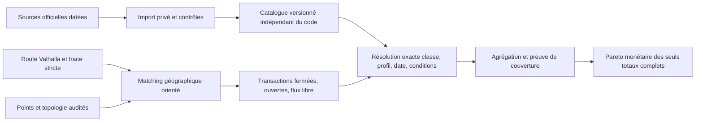

# Moteur tarifaire français — étude expérimentale du 30 octobre 2026

## 1. Conclusion et couverture réellement atteinte

Le calcul factuel en euros est faisable sans approximation kilométrique. Le prototype
sépare détection des transactions, résolution du parcours, catalogue daté et agrégation.
Il **n’est pas un moteur national prêt à intégrer dans V3**.

Sur les 28 routes **réelles de la V3 actuelle**, il produit **22 totaux complets dans le
périmètre manuel audité, dont trois zéros conditionnés aux données routières**, et
**six tarifs partiels**. Les trois zéros ne sont pas des prix confirmés par un opérateur :
ils signifient trace stricte sans marquage payant, aucun point tarifaire recensé traversé
et parcours dans le corridor examiné. Leur niveau de preuve doit rester visible.
Les autres 19 totaux complets citent des cellules officielles APRR 2026.

Le supplément Paris–Rennes fournit un prix Cofiroute réel de **25,20 €** pour une
variante ; cinq autres échantillons des corridors complémentaires restent indisponibles.
La disponibilité documentaire d’un réseau ne vaut pas couverture géographique activée.
Aucun montant A79 2024 n’est promu en 2026 ; aucune multiplication km × taux moyen.

Branche `experiment/fr-toll-engine-2026`, base V3 validée
`026de8c05e4294fba16950f78b5dc53f16e7cca4`. Tous les changements sont dans ce dossier.
La branche V3, `src/`, `server/`, les dépendances, les données produit, Vite et le workflow
Pages restent inchangés. Aucune PR, fusion, modification de l’environnement ou publication.

## 2. Réseaux et sources officielles 2026

Sources obtenues par HTTP public normal, TLS conservé. Aucun compte, jeton extrait,
API privée de calcul, paiement, mécanisme de protection contourné ou scraping intensif.
URL finales, échecs, dates, formats, tailles et SHA-256 sont dans
[sources/observations.json](sources/observations.json). Certaines premières URL ont
répondu 404 ; les liens officiels valides ont ensuite été trouvés via pages/sitemap.
Les refus ATLANDES (CONNECT 403) et ASFA (503) restent des refus, pas des sources valides.

| Réseau | Source(s) effectivement vérifiée(s) | Date d’effet observée | Classes / format / automatisation | Activation |
|---|---|---|---|---|
|APRR|[aprr.html](https://voyage.aprr.fr/tarifs-de-peage) ; [aprr-2026.pdf](https://voyage.aprr.fr/sites/default/files/2026-02/TARIFS_APRR.pdf) ; [aprr-legal.html](https://voyage.aprr.fr/mentions-legales)|2026-02-01|Classes ASFA 1–5, prix TTC standard ; PDF texte, matrice directionnelle et forfaits ouverts ; Import effectivement testé, cellules utilisées seulement|Actif pour corridor Crans audité|
|AREA|[aprr.html](https://voyage.aprr.fr/tarifs-de-peage) ; [area-2026.pdf](https://voyage.aprr.fr/sites/default/files/2026-02/TARIFS_AREA.pdf)|2026-02-01|Classes ASFA 1–5 ; PDF texte, identifiants et paires de gares ; Texte vérifié, adaptateur à développer et géographie à auditer|Aucun prix AREA appliqué|
|VINCI / ASF|[vinci-prices.html](https://www.vinci-autoroutes.com/fr/conseils/autoroute-mode-demploi/tarifs-peage-vinci-autoroutes/) ; [asf.txt](https://public-content.vinci-autoroutes.com/PDF/Tarifs-peage-asf/Tarifs_ASF.txt) ; [asf-c1-2026.pdf](https://public-content.vinci-autoroutes.com/PDF/Tarifs-peage-asf/C1-TARIFS-WEB-2026-maille_maj062026.pdf)|2026-06-01|Classes ASFA 1–5 ; PDF classe 1 examiné ; TXT CSV ; PDF (révision juin, pas seulement février) ; 2055 lignes directionnelles lues ; une ligne avec #N/A pour les 5 classes conservée inconnue|Non activé : matching et exhaustivité non audités|
|Cofiroute|[vinci-prices.html](https://www.vinci-autoroutes.com/fr/conseils/autoroute-mode-demploi/tarifs-peage-vinci-autoroutes/) ; [cofiroute.txt](https://public-content.vinci-autoroutes.com/PDF/Tarifs-peage-Cofiroute/Tarifs_Cofiroute_Arcour.txt) ; [cofiroute-2026.pdf](https://public-content.vinci-autoroutes.com/PDF/Tarifs-peage-Cofiroute/Cofiroute-Guide-tarifaire-2026.pdf)|2026-02-01|Classes ASFA 1–5 ; TXT CSV 11004 paires et guide PDF 143 pages ; Import testé ; cellule classe 1 recoupée PDF p36|Une paire Chartres-Thivars → La Gravelle activée expérimentalement|
|Escota|[vinci-prices.html](https://www.vinci-autoroutes.com/fr/conseils/autoroute-mode-demploi/tarifs-peage-vinci-autoroutes/) ; [escota.txt](https://public-content.vinci-autoroutes.com/PDF/Tarifs-peage-Escota/Tarifs_ESCOTA.txt) ; [escota-2026.pdf](https://public-content.vinci-autoroutes.com/PDF/Tarifs-peage-Escota/Escota-Guide-tarifaire-2026.pdf)|2026-02-01|Classes ASFA 1–5 ; TXT CSV 141 lignes ; guide PDF ; Import testé ; systèmes ouverts/fermés à distinguer|Non activé|
|SANEF|[sanef.html](https://www.autoroutes.sanef.com/fr/tarifs-peage) ; [sanef-2026.pdf](https://www.autoroutes.sanef.com/sites/default/files/2026-01/2026_02-Grille-Sanef.pdf)|2026-02-01|Classes 1–5 ; classe 1 identifiée dans le PDF ; PDF triangulaire, grille et modulation ; Extraction texte possible ; reconstruire axes, sens et règles de modulation|Non activé|
|SAPN|[sanef.html](https://www.autoroutes.sanef.com/fr/tarifs-peage) ; [sapn-2026.pdf](https://www.autoroutes.sanef.com/sites/default/files/2026-01/2026_02-Grille-SAPN.pdf)|2026-02-01|Classes 1–5 ; PDF ; tarification flux libre A13/A14 à traiter par parcours/portiques ; Pas de reconstruction des anciens tickets/barrières après passage au flux libre|Non activé ; Paris-Rennes via A13 reste inconnu|
|ALIAE / A79|[aliae.html](https://www.aliae.com/le-peage-en-flux-libre) ; [aliae-media.html](https://www.aliae.com/medias) ; [aliae-tariff.html](https://paiement.aliae.com/fr/quels-sont-les-tarifs-de-l-a79--8925819183911564158) ; [aliae-linked.pdf](https://paiement.aliae.com/upload/TARIFS_24_v1.pdf)|2024-02-01 seulement pour PDF public obtenu|Classes 1–5 ; colonnes spécifiques très faible émission dans l’ancien document ; Article public → PDF 2024, règles de fonctionnement 2022 citées par audit complémentaire ; Géométrie/portiques et ordre détectés ; montants 2024 refusés en 2026|Aucune grille 2026 vérifiée ; six totaux partiels|
|ATMB|[atmb-tarifs.html](https://www.atmb.com/telepeage-tarifs/tarifs-peage-autoroute-blanche-a40-vehicules-legers/) ; [atmb-2026.png](https://www.atmb.com/app/uploads/2026/01/flyer_tarifs-peage-26-1.png)|2026-02-01 pour A40|Page véhicules légers ; classes/tickets du tunnel distincts ; Page structurée + image PNG 2026 ; lien tunnel séparé ; OCR/lecture humaine à contrôler, séparation classe et période|Non activé ; ne pas transposer le tarif A40 au tunnel|
|SFTRF|[sftrf.html](https://www.sftrf.fr/tarifs-autoroute/) ; [sftrf-2026.pdf](https://www.sftrf.fr/wp-content/uploads/2026/02/Tarifs_autoroute_2026_1.pdf) ; [sftrf-2026-2.pdf](https://www.sftrf.fr/wp-content/uploads/2026/02/Tarifs_autoroute_2026_2.pdf) ; [sftrf-tunnel.html](https://www.sftrf.fr/tarifs-tunnel/)|2026-02-01 pour A43|Classes 1–5 ; véhicules et abonnements/tickets tunnel séparés ; Deux PDF A43, texte extractible ; page tunnel ; Matrices et exceptions à valider ; règles tunnel séparées|Non activé|
|ARCOUR|[vinci-prices.html](https://www.vinci-autoroutes.com/fr/conseils/autoroute-mode-demploi/tarifs-peage-vinci-autoroutes/) ; [cofiroute.txt](https://public-content.vinci-autoroutes.com/PDF/Tarifs-peage-Cofiroute/Tarifs_Cofiroute_Arcour.txt) ; [cofiroute-2026.pdf](https://public-content.vinci-autoroutes.com/PDF/Tarifs-peage-Cofiroute/Cofiroute-Guide-tarifaire-2026.pdf)|2026-02-01 dans guide Cofiroute|Classes 1–5 ; Paires/interconnexions du fichier Cofiroute/Arcour ; Ne pas additionner un second ticket uniquement à un changement de concession|Non activé séparément|
|ARCOS|[vinci-prices.html](https://www.vinci-autoroutes.com/fr/conseils/autoroute-mode-demploi/tarifs-peage-vinci-autoroutes/) ; [arcos.txt](https://public-content.vinci-autoroutes.com/PDF/Tarifs-peage-Arcos/Tarifs_Arcos.txt)|Millésime 2026 annoncé par page VINCI, conditions exactes à importer|Classe et groupe Euro + plages horaires ; TXT avec période, classe, tarif, groupe Euro (encodage cp1252 constaté) ; Rejet délibéré par adaptateur statique ; nécessite calendrier et véhicule Euro|Non activé|
|Duplex A86|[vinci-prices.html](https://www.vinci-autoroutes.com/fr/conseils/autoroute-mode-demploi/tarifs-peage-vinci-autoroutes/) ; [a86.txt](https://public-content.vinci-autoroutes.com/PDF/Tarifs-Duplex-A86/Tarifs_A86.txt)|Millésime 2026 annoncé par page VINCI, calendrier détaillé à vérifier|Contraintes véhicule/hauteur, jour, heure, paiement badge ; TXT avec jour, badge, horaires et sens (cp1252) ; Rejet par adaptateur statique ; ne pas figer un prix par paire|Non activé|
|ALIS|[alis-tarifs.html](https://www.alis-sa.com/fr/preparez-votre-voyage/tarifs-alis-a28-rouen-alencon) ; [alis-2026.html](https://www.alis-sa.com/fr/actualites-alis/actualisation-des-tarifs-du-peage-2026)|2026-02-01 annoncé|Classes et moyens de paiement à valider par tableau ; Page tarifaire/calculateur et communiqué annuel ; Pas de scraping du calculateur ; obtenir grille/fichier autorisé|Source courante identifiée, pas de catalogue activé|
|A’LIÉNOR|[alienor-tarifs.html](https://www.a65-alienor.com/tarifs-de-peage) ; [alienor-2026.pdf](https://www.a65-alienor.com/sites/alienor/files/2026-01/2026%2002%2001%20-%20TARIFS%20A65.pdf)|2026-02-01|Classes 1–5 ; PDF par gare sortie, ligne entrée, colonne classe ; Extraction et validation par station possibles|Non activé|
|CEVM / Viaduc de Millau|[millau-tarifs.html](https://www.leviaducdemillau.com/accueil-viaduc-de-millau/tarifs-du-peage.html)|2026-02-01 ; saison à prendre en compte|Classes et période saisonnière ; Page structurée, lien PDF 2026 ; Forfait ouvrage + saison, pas un prix de toute A75|Non activé|
|ATLANDES|[atlandes.html](https://www.atlandes.fr/fr/tarifs.html) (<urlopen error Tunnel connection failed: 403 Forbidden>)|Non vérifié dans cette session|Non vérifié ; Lien demandé refusé par proxy : CONNECT 403 ; Blocage explicite ; aucun changement d’IP/domaine destiné à le contourner|À étudier via accès autorisé|
|ALBEA|[albea.html](https://www.a150-albea.fr/)|Non vérifié dans cette session|Non vérifié ; Site officiel accessible ; grille 2026 non vérifiée ici ; Étape documentaire supplémentaire nécessaire|À étudier|

L’inventaire structuré [networks.json](sources/networks.json) conserve séparément le
réseau, la classe, le format, les conditions et le niveau d’intégration. Les fichiers
TXT officiels sont des fichiers statiques publics, pas une API métier à disponibilité
ou licence garanties. Aucune API tarifaire publique documentée et autorisée n’a été
validée dans cette étude ; cela ne démontre pas qu’aucune n’existe.

Autres réseaux nécessaires pour une couverture nationale : ADELAC/A41, ALICORNE/A88,
ALBEA/A150, ATLANDES/A63, ARCOUR/A19, ouvrages particuliers (ponts de Normandie et
Tancarville, tunnels concédés, tunnel Maurice-Lemaire), autres petites concessions et
évolutions de réseau. Les autoroutes gratuites hors concession ne doivent pas être
facturées parce que leur nom commence par A. L’inventaire n’est pas une déclaration
exhaustive et vérifiée de tous leurs tarifs 2026.

## 3. Contrôles de sources et formats

- APRR : PDF 300 pages, classes 1–5, effet 01/02/2026. Retéléchargé ; SHA-256
  `f05dfa58cb4ffba8b940b95319186fbf60f86d3791dce6a9df0919946b635d14`,
  **identique au document précédemment audité**. Les 16 cellules distinctes nécessaires
  sont réextraites, pas copiées depuis les anciens totaux de route.
- AREA : PDF texte 13 pages daté 01/02/2026, contrôlé ; pas de tarif AREA appliqué aux
  variantes Crans examinées. Société AREA distincte du groupe APRR.
- SANEF/SAPN : PDF 2026 de six pages chacun, classe 1 clairement identifiée et autres
  classes dans les pages suivantes ; tableaux triangulaires et modulation à reconstruire.
- VINCI ASF : PDF classe 1 applicable **01/06/2026**. Ne pas conserver un seul millésime
  par année ou supposer automatiquement une entrée en vigueur au 1er février.
- Le parseur TXT lit **2055 lignes ASF**, **11004 lignes Cofiroute/Arcour**, **141 lignes
  Escota**. ASF contient une ligne PUYMORENS avec cinq cellules `#N/A` : elles restent
  `null`, jamais zéro. Lecture technique réussie ≠ catalogue national activé.
- A86 et Arcos : les fichiers contiennent horaires/jours/badge ou groupe Euro.
  Leur encodage cp1252 est observé malgré des en-têtes HTTP insuffisants ; l’adaptateur
  statique refuse leurs schémas. Les conditions ne sont pas supprimées pour obtenir
  artificiellement une matrice simple.
- ATMB A40 : date du 01/02/2026 sur la page, grille image PNG liée ; OCR/contrôle humain
  nécessaires. Ne pas confondre avec les classes, forfaits et retours du tunnel Mont-Blanc.
- SFTRF A43 : deux PDF avec prix au 01/02/2026 ; page tunnel Fréjus séparée. Les systèmes
  de classes et tickets des tunnels nécessitent leurs propres règles.
- ALIAE : l’article tarifaire public renvoie encore vers `TARIFS_24_v1.pdf`, dont
  le contenu dit **1er février 2024** et dont l’empreinte est
  `1da8dd12468a025f8648aa3afaae5464f2e24f364a7970a35dfcf8c43f36c128`.
  Aucun montant n’est utilisé pour 2026. La consultation de la médiathèque ne fournit
  pas une matrice 2026 vérifiée. Une moyenne annuelle ou une révision contractuelle
  n’autorise aucune extrapolation des cellules. Cette recherche ne prouve pas
  l’inexistence d’une autre publication ou d’un accord de fourniture possible.

## 4. Architecture et responsabilités

`src/engine.py` ignore la géométrie et les kilomètres ; il résout des règles exactes
et additionne des centimes. `src/matching.py` est l’adaptateur géographique expérimental,
limité aux corridors revus. `src/import_aprr.py` et `src/import_vinci.py` lisent les
formats ; un adaptateur de format n’est pas un adaptateur de concession. `src/run.py`
applique le modèle Crans ; `src/other_corridors.py` éprouve six routes supplémentaires.
Aucun de ces modules n’est importé par l’application V3.

Les montants, dates, points, alias, règles de direction et zones de couverture sont
hors algorithme, dans `catalogs/`. Le helper géométrique éprouvé du premier audit est
réutilisé pour la distance point-segment ; les anciens prix ne pilotent pas les résultats.

## 5. Modèle de transactions

- **Fermé** : entrée canonique orientée → sortie canonique, au sein d’un système
  tarifaire. Une succession A42/A40/A6/A19/A5 peut rester une seule transaction. Un
  changement de concession ou de nom d’autoroute ne crée pas à lui seul un ticket.
  Deux passages séparés comme G009 nécessitent deux transactions réelles.
- **Ouvert** : forfait documenté pour la barrière effectivement traversée ; les
  micro-interruptions de `edge.toll` ne créent pas d’autres paiements. Crottet et
  Myennes sont des points et zones distincts, pas des tarifs au kilomètre.
- **Flux libre** : séquence orientée de portiques/sections avec règle de regroupement
  explicite, gratuités et interconnexion éventuelle. Un portique détecté ne vaut pas
  automatiquement une transaction ; le prix d’un groupe Transit ne se déduit pas
  d’un prix par portique. A79/Deux-Chaises, A13/A14 et Boulay/A4 requièrent leurs règles.
- **Ouvrages et temporalité** : forfaits, saisons, jour, heure de passage dans le
  fuseau Europe/Paris, jours fériés, badge, classe et émission peuvent intervenir.
  Le moteur refuse une règle conditionnelle si son contexte exact n’est pas fourni.
  La résolution d’un calendrier complet A86/Arcos reste à développer ; le test de
  conditions n’est pas une implémentation de ces calendriers réels.

Les tests de flux libre utilisent une fixture synthétique explicitement séparée des
résultats géographiques : ils démontrent qu’une séquence entière est tarifée une fois,
pas que le prototype sait aujourd’hui calculer le prix ALIAE 2026.

## 6. Matching route → transactions et couverture

Le rapprochement repose sur l’ordre de la géométrie et la topologie des gares,
avec un écart point-segment maximal de 12 m, **pas** sur un péage dans un rayon
kilométrique. Chaque événement conserve identifiant OSM, coordonnées, index sur
la forme, distance et preuves. Les noms des gares sont des alias **revus**, pas
un rapprochement flou automatique. La classe, le prix et la fiabilité de la
correspondance sont trois validations indépendantes.

Les traces strictes fournissent `edge.toll`, longueur, noms et indices de forme.
Elles ne donnent ni concessionnaire tarifaire fiable, ni ticket d’entrée, ni
prix. Le référentiel officiel MTE 2025 corrobore les points, mais ses incohérences
n’autorisent pas une correction ou un alias automatique. Sa colonne `concessionPr`
n’est pas un nom d’opérateur. Un simple ref A6 ne distingue pas APRR et ASF.

Les résolutions Val-de-Loing, Val de Saône et Pouilly reprennent les preuves
**topologiques** du complément d’audit, commit `430ad65…`, puis contrôlent leur
passage effectif sur la **géométrie V3 actuelle** et le sens des voies à sens unique.
Les portiques A79 des chaussées opposées distants d’environ 10 m sont distingués
par progression sur la voie OSM. Un nœud appartenant aussi à un toit de péage
n’oblige évidemment pas à suivre ce toit : seules les voies routières requises
figurent dans le modèle. Les revisites de gares détectées sont ambiguës et non
facturées comme une simple première visite ; un vrai matcher de graphe est nécessaire
pour généraliser les boucles et embranchements complexes.

Chaque tronçon marqué payant doit être couvert par une transaction justifiée,
une zone ouverte revue, ou une composante restant explicitement inconnue.
Le modèle conserve des **zones de règlement auditées** : A406 autour de Crottet
et prolongement A6 après la barrière nord de Fleury-en-Bière. Sur les trois parcours
vers Fleury, 3,786 km restent marqués `toll` après le point de règlement ; cela ne
crée pas un deuxième ticket. Ce traitement est conditionné au franchissement
orienté de la bonne gare, à la référence A6 et à une emprise explicite revue.
Il ne consiste pas à élargir globalement la tolérance pour tous les réseaux.
Ces zones restent une validation manuelle spécifique au corridor, **pas une preuve
nationale de couverture**. Hors périmètre ou après expiration de la revue,
le moteur refuse d’affirmer un prix complet.

## 7. Catalogue versionné et provenance

[Schéma JSON](catalogs/catalog.schema.json), [import plan](catalogs/import-plan.json),
[catalogue APRR](catalogs/aprr-2026.json), [cellule Cofiroute](catalogs/cofiroute-2026.json).
Chaque règle conserve identifiant, concessionnaire tarifaire, système, entrée/sortie
ou passages, classe, profil, prix en centimes, source HTTPS, SHA-256, page/ligne/cellule,
confiance et conditions éventuelles. Le catalogue porte devise, date d’effet et
`verified_through`, qui est une limite de notre vérification, **pas la date officielle
de fin de validité du tarif**.

Plusieurs versions peuvent être conservées. Une requête doit tomber dans une seule
version applicable. Des versions qui se chevauchent sans activation univoque sont
refusées ; une paire absente n’est ni retournée à l’envers ni interpolée. Le
[manifeste d’activation](catalogs/activation.json) active uniquement l’expérience,
jamais le produit. Les empreintes du modèle et des catalogues appliqués sont incluses
dans le résultat pour permettre une invalidation du cache prix indépendante du cache
routage : prix = forme/graphe + matcher + catalogue/date + classe/profil + contexte.

## 8. Confiance et statuts

- `complete_verified` : tous les composants et la couverture sont acceptés dans le
  périmètre audité ; tarif standard documenté. Réserve particulière pour les zéros
  prouvés seulement au niveau des données routières. Aucun reçu terrain revendiqué.
- `partial` : au moins une composante actuelle vérifiée, mais tarif ou couverture
  incomplets. `known_cents` est seulement un sous-total ; `total_cents=null`.
- `unavailable` : aucun prix accepté, correspondance non résolue ou hors périmètre.
  Sous-total éventuellement 0, qui n’est jamais affiché comme un total gratuit.
- `stale` : une règle ou une revue correspond mais n’est pas vérifiée pour la date
  demandée. Le montant périmé ne rentre pas dans le sous-total utilisable.

Les détails restent séparés : confiance de mapping, confiance de tarif et preuve de
couverture. Un prix bien sourcé appliqué à une gare ambiguë est quand même refusé.

## 9. Résultat des 28 routes V3 actuelles

[Tableau exhaustif, sous-totaux, transactions et preuves](RESULTS.md),
[JSON machine](results/pricing.json), [CSV](results/comparison.csv).
Entrées prises dans le vrai job V3 `c2cbb984-1221-47ae-98ae-7eef324513b0` : Crans IGN
(45.963641, 5.193902) → 8 Rue de Verdun au Pin (48.914911, 2.628153).
Graphe `3.9.1-f221535`, tileset `1793350533`, 40 profils et 28 analyses strictes
réelles. Ces données géographiques sont exportées et pinées dans `inputs/` ;
aucun nouveau routage n’a été lancé pour fabriquer une correspondance tarifaire.

- G004 : Ambérieu → Les Éprunes, **40,70 €**.
- G009 : Pont-d’Ain → Dijon-Crimolois **16,40 €** + Pouilly-en-Auxois → Les Éprunes
  **22,80 €**, soit **39,20 €** complets.
- G011 : **Villefranche-Nord** → Les Éprunes, **37,90 €**, PDF APRR p287. Les nœuds
  OSM portent Villefranche Nord / APRR / ref31.1. **Ne pas choisir Villefranche-Limas**, dont
  la cellule p285 serait 42,00 €. Le rapprochement par nom de ville seul serait faux.
- G006/G012/G015/G017/G020/G027 : total `null`, au moins A79 non tarifée en 2026.
  Des fragments marqués payants restent aussi imparfaitement couverts dans cinq de ces
  traces ; l’inconnu conserve ces raisons au lieu de les effacer derrière le sous-total.

## 10. Comparaison avec l’ancien audit

Le résultat de comparaison est **22 complets / 6 partiels**, pas 28 complets.
La source APRR inchangée et les nouvelles relectures ne résolvent pas les six tarifs
ALIAE. Les montants APRR sont contrôlés au document courant avant application à
la nouvelle séquence de gares ; les anciens totaux n’entrent pas dans l’algorithme.

0 géométrie actuelle strictement identique à l’archive (extrémités et graphe changés).
27 corridors ont une forte proximité diagnostique ; l’ancien R25 n’est pas retrouvé,
G011 est nouveau. Ainsi, conserver le nombre 22 ne signifie pas conserver à l’aveugle
les mêmes 22 objets. Les correspondances historiques ne servent qu’au rapport.

Les six sous-totaux APRR actuels sont : G006 21,90 €, G012 15,00 €, G015 10,00 €,
G017 15,00 €, G020 14,20 €, G027 5,00 €. Une partie de ces résolutions était déjà
établie dans le complément topologique précédent, sans être intégrée à tous les
sous-totaux du catalogue produit. Ce n’est pas une nouvelle grille A79 ni une
percée tarifaire depuis hier ; les sources actuelles confirment ces cellules APRR.

## 11. Lyon–Bordeaux et Paris–Rennes

Six vrais échantillons, trois variantes par corridor, extraits de la campagne
`6171f70…`, avec géométries, traces brutes et empreintes. Ce sont des archives
réelles, **pas de nouvelles campagnes au graphe du 30 octobre**.

- Paris–Rennes G005, 267,877 min / 383,064 km : entrée Chartres-Thivars,
  sortie La Gravelle, **25,20 €** standard classe 1. TXT officiel et PDF Cofiroute p36
  se recoupent. Les gares et le sens des voies sont contrôlés sur la vraie forme.
  Le point MTE La Gravelle était décalé : il n’a pas été utilisé comme vérité unique.
- Paris–Rennes G004, 220,297 min : entrée virtuelle PARIS/La Folie Bessin non encore
  revue dans ce matcher. G008, 279,858 min : A13/SAPN à flux libre, non implémentée.
  Aucun montant de trajet affirmé pour ces deux variantes.
- Lyon–Bordeaux G003/G015/G004 : 332,807 / 359,886 / 411,423 min, A89/ASF et variantes
  pouvant emprunter A71/A714 et des sections non concédées. Fichier ASF disponible,
  mais inventaire des entrées/sorties, règles d’interconnexion et couverture non audités
  pour ces routes : **tarif non disponible**. Ne pas transformer cette limitation du
  matcher en affirmation que les tarifs ASF seraient introuvables.

L’objectif de découverte est atteint : il faut au minimum Cofiroute et ASF au-delà
d’APRR, et SAPN/flux libre pour certaines variantes. Les modèles Crans ne se
transposent pas à ces corridors en changeant simplement deux coordonnées.

## 12. Vraie frontière temps/euros

Huit compromis parmi les **seuls totaux complets** :
G004 → G007 → G014 → G021 → G028 → G025 → G022 → G001.
Le tableau de durée/prix/détour/économie/€/minute est dans [RESULTS.md](RESULTS.md).
Référence la plus rapide : G004, 298,4188 min et 40,70 €.

Les six partiels ne contribuent ni à cette frontière ni aux économies. On ne compare
jamais leurs sous-totaux à des totaux. G011 est complet mais dominé. Cette frontière
n’est ni la frontière temps/exposition ni un optimum national. Les trois zéros
routiers conservent leur réserve de preuve ; sans eux, une étude plus stricte des
seuls prix opérateur aurait une frontière différente, à ne pas dissimuler.

## 13. Cas encore impossibles ou refusés

A79 2026 et regroupements courants, A13/A14 et Boulay sans règles activées,
entrées virtuelles non résolues, nouveaux systèmes hors modèle, boucles et directions
ambiguës, références géographiques contradictoires, modifications de gares, classes
ou abonnements non couverts, heures/conditions manquantes, documents périmés ou
changés de structure. Pas de remplacement par prix moyen, cellule voisine, moyenne
annuelle, tarif le plus bas, opérateur présumé ou approximation par kilomètres.

## 14. Mise à jour sans réécriture de l’application

1. **Découverte autorisée** : relever les liens officiels, dates d’effet et droits.
   Ne pas rendre un calculateur interdit indispensable au pipeline.
2. **Staging privé immuable** : télécharger l’original destiné à la lecture publique,
   conserver URL/date/type/hash, vérifier TLS et signature PDF `%PDF`/format attendu.
   Toute différence par rapport au pin interrompt une restauration ; un nouveau hash
   n’est accepté qu’après nouvel audit explicite du contenu.
3. **Import** : plan JSON avec date/classe/source ; l’adaptateur APRR teste l’en-tête
   contre ce plan. Le test 2027 prouve que changer d’année ne demande pas de modifier
   l’algorithme. Un changement de **format** peut légitimement demander un nouvel
   adaptateur, sans réécrire le frontend ni le moteur de calcul.
4. **Validation** : schéma, centimes, absence des `#N/A`, unicité directionnelle,
   conflits de versions, totaux de référence, contrôle échantillonné visuel/PDF et
   comparaison aux sorties de l’année précédente (alerte, pas correction automatique).
   Préserver asymétries et classes, sans imposer une monotonie inventée.
5. **Revue humaine du mapping et des droits** : nouvelles gares, concessions,
   portiques, périodes et gratuités. Revue distincte des prix et de la topologie.
6. **Tests et activation** : catalogue versionné, manifeste d’activation revu,
   conservation des anciens millésimes et retour arrière. En production, faire
   pointer atomiquement le service sur la version choisie ; ici seul le manifeste
   expérimental change, aucun effet sur V3.
7. **Cache et surveillance** : invalider par catalogue/matcher/classe/date/contexte,
   conserver le routage compatible, détecter sources changées et mises à jour
   intrannuelles. Aucun rafraîchissement quotidien agressif ; contrôle planifié
   aux dates annoncées et fréquence raisonnable conforme aux conditions.

La commande de reproduction par pin et les imports sont dans [README.md](README.md).
Les matrices complètes lues restent privées ; seuls les faits nécessaires à cette
étude sont conservés dans les catalogues versionnés.

## 15. Trajectoire nationale réaliste

Étape 1 : industrialiser APRR/AREA et Cofiroute, avec inventaire orienté de points,
paire inter-réseau et quelques centaines de trajets de validation indépendants.
Étape 2 : intégrer les TXT ASF/Escota après revue des droits, des lignes absentes et
de la topologie ; étendre les corridors Lyon–Bordeaux et Paris–Rennes sans prétendre
que toute A89 ou A11 constitue une seule transaction. Étape 3 : SANEF/SAPN et flux
libre, en priorité les grilles et règles A79 actuelles. Étape 4 : petites concessions,
ouvrages, profils et modulations, avec une matrice de couverture mesurée.

Mesurer séparément couverture documentaire, couverture de règles, couverture
spatiale, taux de totaux complets et erreurs constatées. Maintenir des jeux où le
bon résultat attendu est **inconnu**. L’objectif intermédiaire doit être « des
corridors justifiés et des refus propres », pas une promesse France entière avant
qualification des systèmes et droits.

## 16. Risques juridiques et techniques

Les grilles publiques ne constituent pas une licence ouverte de reproduction massive.
APRR réserve explicitement les droits dans les mentions légales consultées. Pour
les autres opérateurs, aucune licence ouverte vérifiée dans cette étude : demander
une clarification contractuelle avant diffusion commerciale d’une base complète.
Pas de revendication que le faible nombre d’extraits factuels suffirait, à lui seul,
à lever tout droit de base de données. Aucune demande n’a été envoyée à un opérateur.

PDF, pages, images et TXT complets restent dans `local/`, ignoré ; aucun original
n’est ajouté au dépôt. Les sources géographiques dérivées OSM nécessitent attribution
et respect de l’ODbL ; le référentiel MTE est ODC-BY selon ses métadonnées. Séparer
la provenance des faits tarifaires et celle des bases géographiques lors d’une future
redistribution. Les documents contractuels et les anciens audits ne valent pas une
validation juridique de la future offre.

Risques techniques : mauvaise bretelle ou sens opposé, classer un entretien APRR comme
concession APRR, péage ouvert pris pour entrée, double comptage à une interconnexion,
portique gratuit ou groupe Transit, PDF visuel mal OCRisé, inversion de ligne/colonne,
prix changé en cours d’année, cache d’un autre profil, majorations/remises, fuseau et
jours fériés, inventaire incomplet. Les réserves du modèle géographique doivent rester
visibles même lorsqu’un prix de cellule est parfaitement confirmé.

## 17. Tests et reproduction

Tests expérimentaux : source/datage/classe, montants entiers, schéma et doublons,
absence de retournement/interpolation, mapping/tarif indépendants, millésimes et
chevauchements, futur import 2027 piloté par données, conditions heure/paiement,
séquence flux libre non additive, sous-total jamais total, Pareto excluant les
inconnus, refus des traces invalides/hors périmètre, sens OSM opposé/toit, pins des
vraies entrées, 28 résultats, cellule Villefranche-Nord contre Limas, deux tickets
G009, et cellule Cofiroute réelle.

Le test d’intégration du PDF APRR a été **exécuté**, pas ignoré : les 16 cellules
appliquées sont recoupées au document officiel retéléchargé et au numéro de page.
Les résultats réels ne sont pas les fixtures synthétiques de test.
Le nombre final des tests et contrôles exécutés est conservé dans [VALIDATION.md](VALIDATION.md).

## 18. Branche et commit

Branche expérimentale `experiment/fr-toll-engine-2026` créée depuis la V3 validée.
Les changements et le rapport sont enregistrés dans le commit indiqué au compte
rendu final et consultable par `git log -1`. Le SHA n’est pas incorporé au fichier
qu’il identifie. Aucune PR, fusion dans main ou intégration dans la V3.
