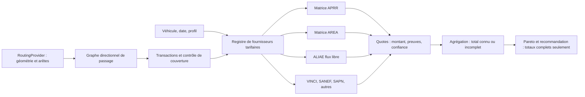

# Extension progressive du moteur tarifaire

Le travail courant reste un **audit hors ligne**, sans API nationale, backend, nouveau calcul Valhalla ou changement de l’application. `engine.py` expose des contrats minimaux réutilisables ; l’extraction des 28 archives reste dans `run.py`.

## Contrats mis en place

- `Vehicle` : classe et profil standard explicites. Les futures réductions Crit’air 0, normes Euro, abonnements et hauteur/PTAC doivent être des paramètres sourcés, pas déduits d’une plaque française.
- `Traversal` : **concession tarifaire** distincte de l’exploitant, système fermé/ouvert/flux libre, entrée, sortie, passages ordonnés, confiance et preuves géographiques.
- `TariffProvider.quote(traversal, vehicle, date)` : montant en centimes ou inconnu, preuve primaire et confiance tarifaire. Aucune requête réseau cachée et aucune estimation kilométrique.
- `DatedMatrixProvider` : cellule exacte orientée ; refuse une date hors de l’audit, un autre millésime/classe/profil, un autre concessionnaire, un sens inverse non publié ou un conflit de cellules.
- `UnverifiedFreeFlowProvider` : conserve les passages ALIAE mais renvoie explicitement inconnu tant que le catalogue courant et les règles ne sont pas validés.
- `aggregate(..., coverage_complete=...)` : somme seulement les sections acceptées. Toute section ambiguë/inconnue ou lacune de couverture maintient `total_cents=null`. Le sous-total n’est jamais un total implicite.

## Couches à ajouter ultérieurement

1. **Registre géographique directionnel versionné** : identifiants propres des gares/portiques/échangeurs et alias OSM/MTE/opérateur ; géométrie de voies et sens, type de perception, provenance et conflits. Des nœuds voisins ne sont pas interchangeables. Conserver les visites répétées sur un même trajet.
2. **Automate de transactions** : ouverture/fermeture des tickets, forfaits ouverts, gratuités et regroupements flux libre. Une interruption de `edge.toll` n’est pas une transaction ; un changement de concession n’est pas forcément une nouvelle perception. Modéliser les matrices et accords inter-réseaux pour éviter de facturer deux fois un trajet interconnecté déjà couvert par une cellule publiée.
3. **Catalogues par concession et millésime** : APRR et AREA séparés ; ALIAE spécifique ; puis ASF/ESCOTA/COFIROUTE, SANEF/SAPN et autres. Chaque import conserve document, hash, page/cellule, classe, profil et dates vérifiées. Identité d’une marque commerciale ou d’un mainteneur ne remplace pas celle d’une concession.
4. **Fournisseur flux libre** : règles de parcours, ordre et direction des portiques, groupes Est/Ouest/Transit, fenêtres temporelles éventuelles, gratuités et modulations. Les identifiants physiques ne sont pas nécessairement les unités de prix. Les règles ALIAE ne sont pas transposables automatiquement à SANEF/SAPN.
5. **Contrôle de couverture** : toute portion potentiellement tarifée doit être reconnue, explicitement gratuite ou non résolue. Des requêtes Overpass sans résultat ne prouvent pas la gratuité. Ne pas confondre incertitude de prix et incertitude de correspondance.
6. **Validation avant affichage** : tests de contrats, parcours de référence par réseau, contre-exemples directionnels, dates et remises, comparaisons à des factures anonymisées ou confirmations opérateurs si disponibles. Clarifier les licences de réutilisation et les mécanismes de mise à jour avant intégration produit.

Le registre actuel de trois correspondances auditées n’est pas étendu artificiellement à toute la France. Le calcul expérimental réemploie ces correspondances par identité de gare et contrôles de voies ; il ne contient pas de tableau `route_id → prix` comme moteur. Les identifiants Rxx servent seulement à lire et comparer les archives.
